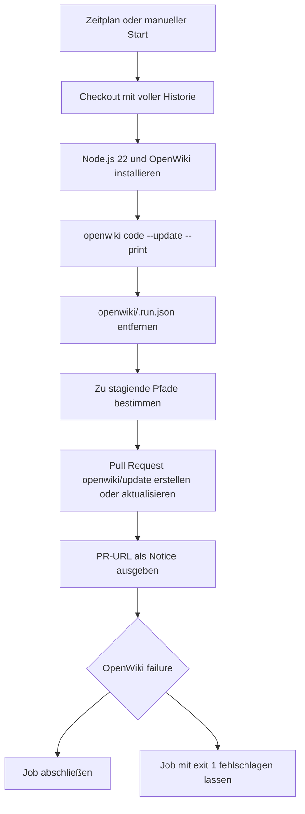

# OpenWiki-Aktualisierungsautomatisierung

Die Datei [`.github/workflows/openwiki-update.yml`](../../.github/workflows/openwiki-update.yml) betreibt die Aktualisierung des Repository-Wikis. Sie beschreibt die Dokumentationsautomation, nicht das Verhalten eines Produkts. Für den knappen Einstieg und den derzeitigen Repository-Kontext siehe [Schnellstart](../quickstart.md).

## Auslöser, Rechte und Laufzeitumgebung

Der Workflow **OpenWiki Update** hat genau einen Job `update`, der auf `ubuntu-latest` läuft. Er kann über `workflow_dispatch` manuell gestartet werden und wird außerdem nach dem Cron-Ausdruck `0 8 * * *` geplant ausgelöst. Zum Schreiben der Ergebnisse benötigt der Workflow die Berechtigungen `contents: write` und `pull-requests: write`.

Der Checkout verwendet `actions/checkout` mit `fetch-depth: 0`. Das ist eine funktionale Voraussetzung für inkrementelle Aktualisierungen: `openwiki code --update` muss `HEAD` gegen den Commit vergleichen können, den es zuletzt dokumentiert hat. Ein flacher Checkout würde diesen Commit verbergen und laut Workflow-Kommentar zu einer leeren Änderungszusammenfassung führen.

Danach installiert der Job Node.js 22 und installiert global die fest versionierten Pakete:

```text
openwiki@0.7.2 mermaid@11.16.0 jsdom@29.1.1
```

`mermaid` und `jsdom` sind dabei laut Konfiguration optionale Abhängigkeiten für die höherwertige Validierung von Mermaid-Diagrammen; sie können entfernt werden, falls das Wiki keine solchen Diagramme enthält. Die Actions selbst sind auf konkrete Commit-Referenzen gepinnt.

## Ablauf und Fehlerpfad



*Kontrollfluss vom Auslöser bis zum PR-Staging und zur nachgelagerten Fehlerweitergabe.*

Der OpenWiki-Schritt hat `continue-on-error: true`. Deshalb wird ein Fehlschlag zunächst als Ergebnis des Schritts festgehalten, anstatt die nachfolgenden Bereinigungs- und PR-Schritte abzubrechen. Der Aufruf lautet:

```text
openwiki code --update --print
```

Er erhält seine Provider- und Modellkonfiguration aus `OPENWIKI_PROVIDER=openai` und `OPENWIKI_MODEL_ID="gpt-5.6-terra"`; `OPENAI_API_KEY` wird aus dem gleichnamigen GitHub-Secret bezogen. Für den LangSmith-Connector wird `OPENWIKI_LANGSMITH_API_KEY` als Secret übergeben. Weitere Workspaces werden durch zusätzlich konfigurierte Secrets und Umgebungsvariablen mit Suffixen `_2`, `_3` usw. vorgesehen. Unabhängig davon ist die Ablaufverfolgung dieses Laufs optional über `LANGSMITH_API_KEY`, `LANGCHAIN_PROJECT=openwiki` und `LANGCHAIN_TRACING_V2="true"` konfiguriert.

Solange der Workflow nicht abgebrochen wurde, entfernt er anschließend ausschließlich die transiente Datei `openwiki/.run.json`.

## Pull Request als Fortschrittsgrenze

Vor dem PR-Schritt baut ein Shell-Schritt die Liste der zu übernehmenden Pfade. Standardmäßig sind das `openwiki`, `AGENTS.md` und `.github/workflows/openwiki-update.yml`; `CLAUDE.md` wird nur ergänzt, wenn die Datei existiert. Diese Existenzprüfung ist wichtig, weil `git add` bei einem fehlenden Pfad fehlschlagen und dann nichts stagen würde.

`peter-evans/create-pull-request` erstellt oder aktualisiert mit dieser Liste einen PR auf dem Branch `openwiki/update`. Commit-Nachricht und Titel sind jeweils `docs: update OpenWiki`. Der PR-Text enthält das Ergebnis des OpenWiki-Schritts. Falls dieses `failure` lautet, bleibt der bis dahin fertiggestellte Seitenstand bewusst im PR erhalten. Maintainer können ihn mergen, damit dieser Teilfortschritt die Basis für den nächsten geplanten Lauf wird. Wenn der PR eine URL liefert, schreibt der Workflow sie zusätzlich als GitHub-Actions-Notice.

Der letzte Schritt macht einen zuvor abgefangenen OpenWiki-Fehler wieder sichtbar: Bei `steps.openwiki.outcome == 'failure'` beendet `exit 1` den Job fehlerhaft. Damit gelten zwei Eigenschaften gleichzeitig: Ein PR kann auch bei Teilfortschritt erstellt werden, und der Workflow wird trotzdem nicht fälschlich als erfolgreich angezeigt. Bei einer Abbruchausführung (`cancelled()`) werden Bereinigung, Pfadermittlung, PR-Erstellung und Notice übersprungen; der separate Fehlerweitergabe-Schritt ist nur an das OpenWiki-Ergebnis gebunden.

## Sicher ändern und betreiben

- **Inkrementalität bewahren:** `fetch-depth: 0` nicht auf einen flachen Checkout reduzieren, solange der Update-Befehl den zuletzt dokumentierten Commit zum Diff benötigt.
- **Secrets nicht in die Datei schreiben:** API-Schlüssel bleiben GitHub-Secrets und werden nur über die `env`-Zuordnung in den OpenWiki-Schritt gereicht. Beim Hinzufügen weiterer LangSmith-Workspaces müssen Secret und passende Umgebungsvariable gemeinsam ergänzt werden.
- **PR-Staging bewusst pflegen:** Änderungen an weiteren Eingaben oder erzeugten Dokumentationspfaden erfordern eine Anpassung der Pfadliste. Insbesondere darf ein optionaler Pfad nicht bedingungslos in `add-paths` gelangen.
- **Teilfortschritt auswerten:** Ein fehlerhafter Lauf kann dennoch einen aktualisierten `openwiki/update`-PR hinterlassen. Dessen Ergebnisangabe prüfen und die fertiggestellten Seiten bei Bedarf mergen; anschließend kann der nächste Lauf auf diesem Stand weiterarbeiten.
- **Fehlersemantik erhalten:** `continue-on-error` nur zusammen mit der abschließenden Fehlerweitergabe verwenden. Ohne den letzten `exit 1` würden fehlgeschlagene OpenWiki-Läufe nach erfolgreichem PR-Staging als erfolgreiche Jobs erscheinen.
